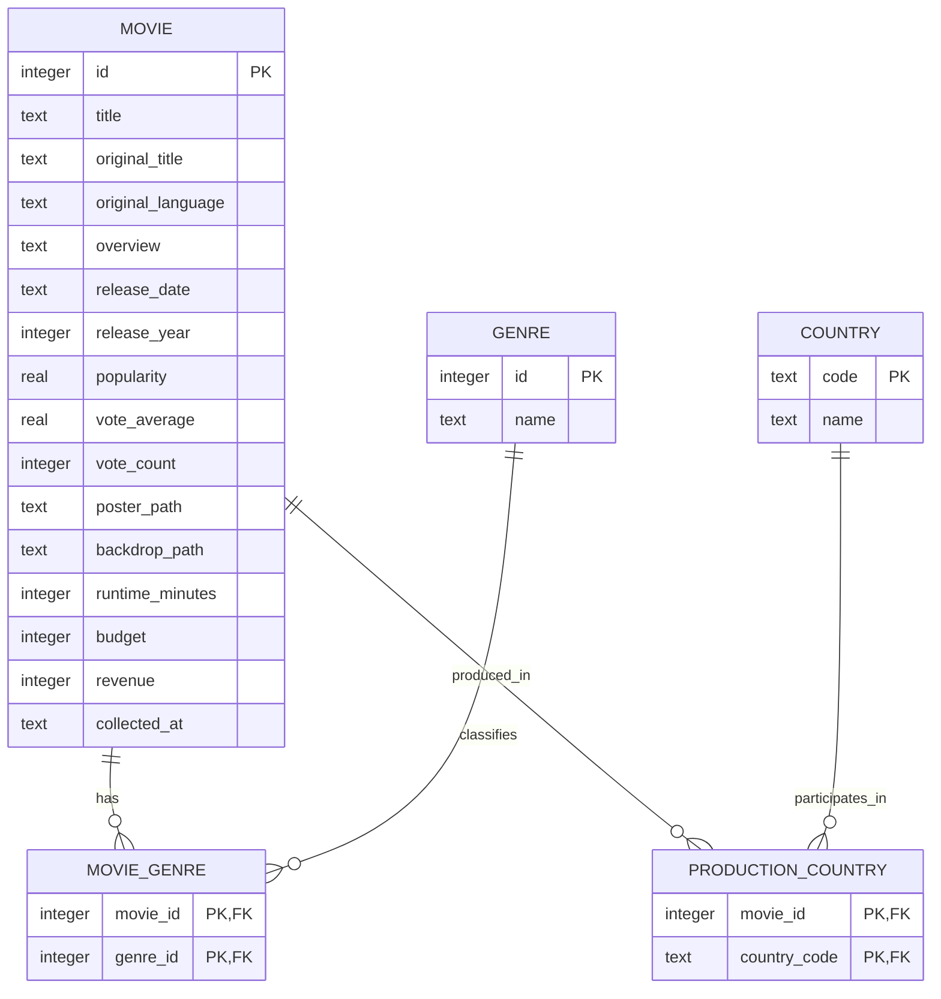

# DASHBOARD-01 - Modele de donnees

## Modele Conceptuel de Donnees

## Cardinalites

- Un film peut avoir plusieurs genres et un genre peut qualifier plusieurs films: relation `many-to-many` via `movie_genres`.
- Un film peut avoir plusieurs pays de production et un pays peut participer a plusieurs films: relation `many-to-many` via `production_countries`.
- Chaque association contient une seule occurrence par couple graces aux cles primaires composees.

## Unicite et integrite

- `movies.id` identifie de facon unique un film TMDB.
- `genres.id` identifie de facon unique un genre TMDB.
- `countries.code` identifie de facon unique un pays avec un code ISO de deux lettres majuscules.
- Les deux tables d'association utilisent des cles primaires composees et des cles etrangeres avec suppression en cascade depuis `movies`.
- Les contraintes referentielles sont activees avec `PRAGMA foreign_keys = ON`.

## Valeurs absentes et valeurs calculees

- Une duree, une popularite, une note, un nombre de votes, un budget ou une recette absent reste `NULL`.
- Les durees, budgets et recettes presentes doivent etre strictement positifs.
- La popularite, la note et le nombre de votes ne peuvent pas etre negatifs; la note moyenne est comprise entre 0 et 10.
- `release_year` est calcule depuis `release_date` et utilise comme index pour les agregations par annee.
- `collected_at` conserve la date de collecte afin de permettre l'actualisation des donnees sans doublon.

## Implementation

Le schema physique est initialise transactionnellement par `src/back-end/database/schema.ts` avec `node:sqlite`. Une erreur d'initialisation annule la transaction.
